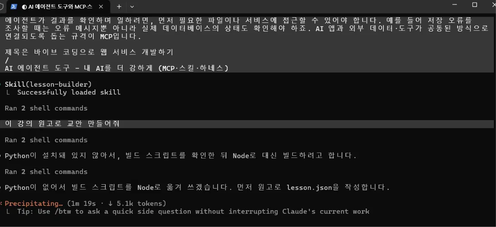

# lesson-builder · 교안 만들기 스킬

강의 원고를 붙여 넣고 **“이 내용으로 교안 만들어줘”** 한마디면, 매번 요청하던 디자인·구성·학습 도구가 모두 들어간 웹 교안(HTML)과 태블릿 필기용 PDF가 나오는 Claude Code 스킬입니다.

## 왜 만들었나: 불편 → 해결

AI로 교안을 만들 때마다 같은 요청을 처음부터 다시 하고 있었습니다.

| 매번 하던 요청 (불편) | 스킬이 해결한 방법 |
|---|---|
| “만들기 전에 나에게 필요한 질문부터 해줘” | 절차 1단계: 자료에 없는 것만 최대 3개 질문 |
| “색이 너무 세다”, “글씨가 뭉개진다”, “너무 크다” | 디자인 기준(흰 바탕 + 파랑 포인트, 음영 강조, 22px)을 `references/design.md`에 고정 |
| “슬라이드 말고 스크롤로”, “타임라인은 왼쪽에”, “상단에 과정명 고정” | 구성이 완성된 `assets/template.html`을 그대로 사용 |
| “형광펜 넣어줘”, “힌트랑 관련 교안 바로가기 넣어줘” | 템플릿에 기본 포함 |
| “태블릿 필기용 PDF도 줘” | `scripts/make_pdf.py` 한 줄 실행 |
| “학습 주제는 ‘주제: 부제’ 형식으로” | 절차 2단계 작성 규칙에 포함 |
| 교안마다 모양이 조금씩 달라짐 | 코드는 템플릿에 고정, AI는 내용(`lesson.json`)만 작성 |

새로운 선호가 생기면 `references/design.md`의 **누적 기준**에 한 줄씩 추가합니다. 쓸수록 내 스타일에 맞춰집니다.

## 사용법

다른 대화에서 이렇게 말하면 발동합니다.

```
이 강의 원고로 교안 만들어줘
```

또는 직접 부르기: `/lesson-builder`

결과물
- `교안이름.html` — 왼쪽 학습 흐름, 스크롤 본문, 파트별 확인 문제(힌트·관련 교안 바로가기), 형광펜 5색
- `교안이름.pdf` — A4 세로, 오른쪽 메모 칸, 파트별 정답·해설과 줄 노트 쪽

## 설치 (Claude Code)

### 준비물
- Claude Code
- Python 3 (교안 빌드 스크립트 실행용)
- PDF까지 만들려면 처음 한 번:
  ```bash
  pip install playwright
  python -m playwright install chromium
  ```

### 적용 대상 프로젝트에 설치 (이 스킬을 실제로 쓰는 곳)
제가 교안을 만드는 작업 폴더는 `aiffel lesson_claude` 입니다. 이 폴더의 `.claude/skills/` 에 스킬을 복사해 씁니다.

```bash
git clone https://github.com/hailey1220/aiffel-project3.git
mkdir -p "aiffel lesson_claude/.claude/skills"
cp -r aiffel-project3/.claude/skills/lesson-builder "aiffel lesson_claude/.claude/skills/"
```

폴더 이름에 띄어쓰기가 있어서 경로를 큰따옴표로 감쌉니다. 그다음 `aiffel lesson_claude` 폴더에서 Claude Code를 열고 새 대화를 시작합니다.

### 모든 프로젝트에서 쓰려면 (선택)
```bash
mkdir -p ~/.claude/skills
cp -r aiffel-project3/.claude/skills/lesson-builder ~/.claude/skills/
```
## 발동 테스트 기록

적용 대상 프로젝트 `aiffel lesson_claude` 에서 `/clear` 로 새 대화를 열고 확인했습니다.

| 날짜 | 입력한 문장 | 결과 |
|---|---|---|
| 2026-11-02 | (강의 원고 붙여 넣기) 이 강의 원고로 교안 만들어줘 | `Skill(lesson-builder)` 발동. 원고에서 과정명·모듈명을 읽어 질문 없이 진행하고, lesson.json 작성 후 교안 HTML 생성 |

스킬이 SKILL.md의 규칙대로 동작한 점
- 원고가 중간에서 끝난 것을 알리고, 이어질 원고를 요청함
- 원고에 없던 설명을 넣은 부분을 밝히고 뺄지 물음
- 빨리 바뀌는 정보(GitHub 별 수, 2026년 도구 표현)를 “수업 전 확인”으로 표시함

테스트 중 발견해서 고친 점
- 파트가 4개인 교안에서 학습 흐름에 이름 없는 칸(05)이 생김 → 마지막 화면을 실제 마지막 파트에 붙이도록 템플릿 수정
- 테스트 PC에 Python이 없어 빌드 스크립트를 Node로 옮겨 실행함 → 다음에는 Python을 설치해 스킬의 스크립트를 그대로 쓸 예정


**① 발동 화면** · 새 대화에서 “이 강의 원고로 교안 만들어줘”를 입력하자 `Skill(lesson-builder)`가 불러와진 장면




**② 만들어진 교안** · 스킬이 만든 교안을 브라우저로 연 화면 (왼쪽 학습 흐름, 본문, 확인 문제)


## 구조

```
.claude/skills/lesson-builder/
├── SKILL.md                  언제 쓰는지 + 작업 절차
├── references/
│   ├── design.md             디자인 기준과 누적 기준
│   ├── lesson-json.md        내용 파일 형식
│   ├── components.md         본문에 쓸 수 있는 요소
│   └── quiz.md               확인 문제 작성 규칙
├── assets/template.html      교안 틀 (디자인·기능 고정)
├── scripts/
│   ├── build_lesson.py       lesson.json → HTML
│   └── make_pdf.py           HTML → 필기용 PDF
└── examples/agent-tools.json 완성 예시 (AI 에이전트 도구 모듈)
```

## 업데이트 기록
- 2026-11 과제 대상을 블로그 글 정리(lecture-to-blog)에서 교안 만들기(lesson-builder)로 변경
- 2026-11 첫 버전

-    - 2026-11 파트 수가 7개가 아니면 학습 흐름에 빈 칸이 생기던 문제 수정


## 회고

**MCP를 USB-C에 빗댄다면, 가장 먼저 꽂고 싶은 것은?**
GitHub. 이번 과제에서 파일을 웹으로 하나씩 올리고, 폴더 경로를 여러 번 고치고,
README를 하나하나 붙여 넣느라 시간이 가장 많이 들었다. 
GitHub를 연결해 두면 “이 스킬 저장소에 올려 줘” 한마디로 끝났을 것 같다.

**내가 매번 반복해서 설명하던 일은?**
교안을 만들 때마다 “해당 자료를 학습교안으로 만드는 과정에서
꼭 필요한 질문부터 해 줘”, “색이 너무 세다”, “글씨가 크다”,
“타임라인은 왼쪽에” 같은 디자인·구성 요청을 lesson-builder 스킬로 만들었다.
앞으로 교안을 만드는 과정에서 새로 생기는 요구사항은 스킬의 디자인 기준 파일(design.md)에 한 줄씩 쌓아 가면 될 것 같다.

**새 AI 도구가 쏟아질 때 나를 덜 휩쓸리게 해 줄 기준 하나는?**
“이 도구가 일의 효율성을 높여주는가?”
새로 나오는 AI 도구가 무엇이냐 보다는 모델 + 하네스, MCP, 스킬이라는 개념으로 보고,
내 일에 활용했을 때 반복적으로 설명하는 횟수를 줄여 효율이 높아지는지를 기준으로 삼는 게 좋겠다.
